<p align="center">
  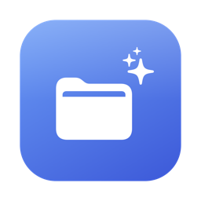
</p>

<h1 align="center">Notchi</h1>

<p align="center">
  Notch MacBook Anda jadi pusat kendali. Satu panel yang turun dari notch, berisi
  musik, acara hari ini, perapian folder, suhu, sistem, timer, dan banyak lagi.
</p>

<p align="center">
  <a href="https://github.com/rlyno/notchi/releases/latest"><b>Unduh versi terbaru</b></a>
  &nbsp;·&nbsp; macOS 26 atau lebih baru &nbsp;·&nbsp; Apple Silicon & Intel &nbsp;·&nbsp; Gratis
</p>

**Semuanya berjalan di Mac Anda.** Tanpa akun, tanpa telemetri, tanpa iklan. Notchi tidak
menyentuh jaringan kecuali Anda sendiri yang menyalakan pemeriksa versi atau Cuaca.

<p align="center">
  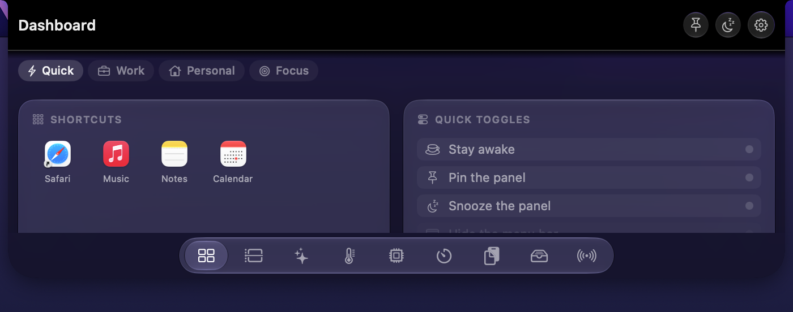
  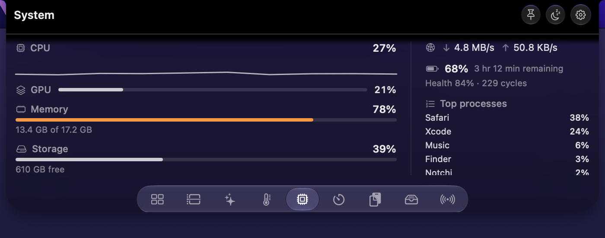
  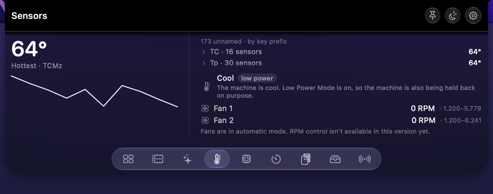
  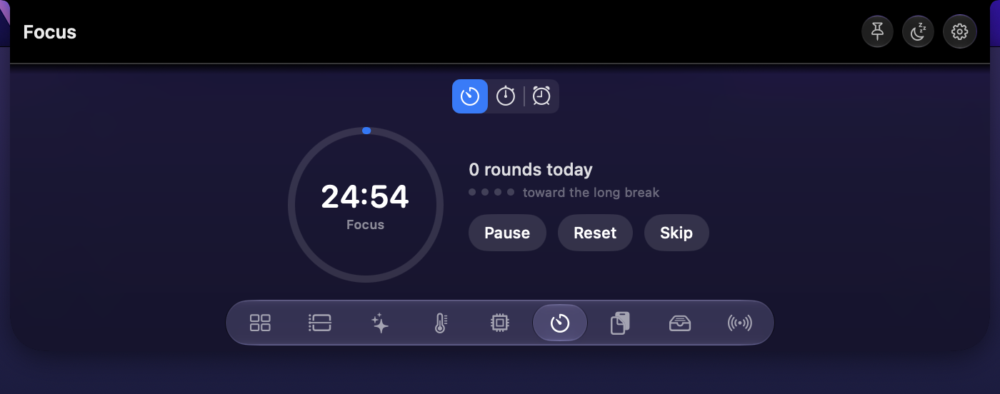
</p>

## Unduh

1. Unduh `Notchi.dmg` dari [halaman rilis terbaru](https://github.com/rlyno/notchi/releases/latest).
2. Buka `.dmg`, lalu seret **Notchi** ke folder **Applications**.
3. Buka **Terminal**, salin-tempel baris ini, lalu tekan Enter:

   ```bash
   xattr -rd com.apple.quarantine /Applications/Notchi.app
   ```

4. Buka Notchi. Panelnya muncul di notch — tekan `⌥⌘N` atau klik notch untuk membukanya.

Langkah 3 sifatnya **sementara**: ia menghapus tanda *quarantine* yang dipasang macOS pada
aplikasi unduhan. Tidak mau menyentuh Terminal? Lewati langkah itu, buka Notchi, lalu saat macOS
menolaknya buka **System Settings → Privacy & Security** dan tekan **Open Anyway**.

Mulai 1.1, memperbarui jauh lebih mudah: nyalakan pemeriksaan versi di **Pengaturan → Umum**, dan
saat versi baru ada tekan **Unduh & pasang**. Izin dan setelan Anda tetap utuh.

Pemakai macOS 14 dan 15 berhenti di [0.9.3](https://github.com/rlyno/notchi/releases/tag/v0.9.3),
yang tetap tersedia.

## Yang bisa dilakukan

| | |
| --- | --- |
| **Panel notch** | Diintip saat kursor lewat, dibuka dengan klik, `⌥⌘N`, atau usapan dua jari ke bawah. Di Mac tanpa notch ia jadi pil mengambang di tengah atas layar |
| **Notch yang diam** | Mengabarkan satu hal pada satu waktu: lagu yang diputar (berwarna sampulnya), sisa waktu Pomodoro, kabel daya yang dicolok, kamera atau mikrofon yang sedang dipakai, headphone Bluetooth yang baru tersambung, perubahan volume, dan unduhan yang selesai |
| **Dashboard** | Kisi kartu dengan empat profil — Cepat, Kerja, Pribadi, Fokus — berisi musik, acara, pintasan, dan sakelar cepat |
| **Hari Ini** | Garis waktu satu jalur: acara, pengingat, tugas, dan penanda tidur |
| **Rapikan** | Pindai folder yang berantakan, tinjau rencananya, rapikan, dan batalkan kapan saja |
| **Sensor & Sistem** | Suhu tiap sensor dan RPM kipas; CPU, GPU, memori, penyimpanan, jaringan, kesehatan baterai, dan lima proses terberat |
| **Fokus** | Pomodoro, stopwatch dengan putaran, dan alarm jam yang bisa diketik waktunya |
| **Papan Klip & Rak** | Riwayat salinan, dan rak tempat berkas yang dijatuhkan ke notch menunggu diseret keluar lagi |
| **Bluetooth** | Perangkat yang dipasangkan beserta baterainya |
| **Menu Bar** | Menyembunyikan dan menata item menu bar (di macOS 27 fitur ini diurus macOS sendiri) |

Tiap modul bisa dimatikan dan diurutkan ulang di **Pengaturan → Modul**. Panelnya bisa
**disematkan** (`⌥⌘P`) supaya tetap terbuka, atau **ditidurkan** (`⌥⌘S`) saat sedang mengganggu.

Setelan opsional di **Pengaturan → Notch**, semuanya mati sampai Anda nyalakan: **warna panel**,
**cermin kamera** untuk berkaca sebelum rapat, **perubahan volume** di notch (bisa juga
menggantikan indikator volume macOS), dan **unduhan selesai**.

<details>
<summary><b>Tampilan tiap modul</b></summary>

<br>

Tangkapan dari versi 0.9.5; tampilan 1.1 sedikit berbeda (misalnya baris GPU di modul Sistem).

**Notch yang diam** — terlihat seperti notch asli.


**Dashboard**


**Hari Ini**

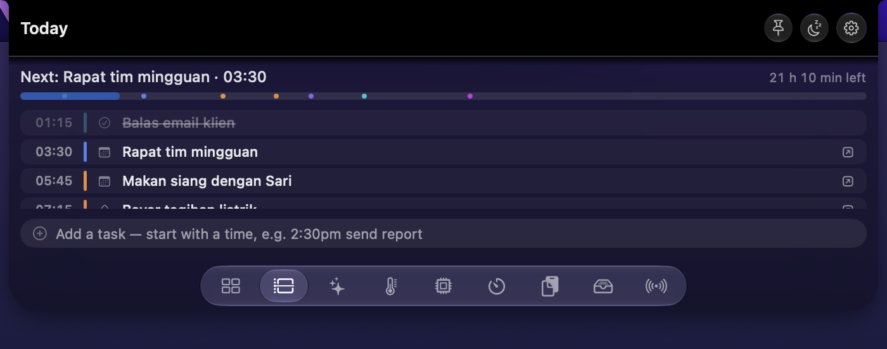

**Rapikan**

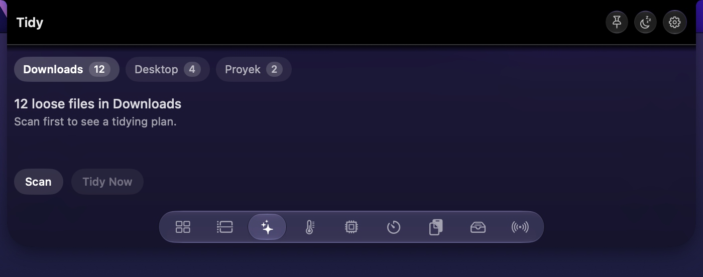

**Menu Bar**

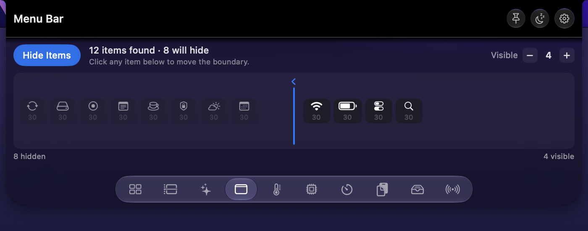

**Sensor**


**Sistem**


**Fokus**


**Papan Klip**

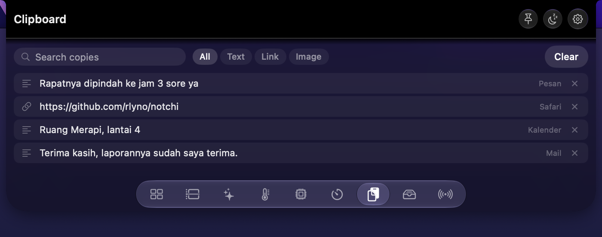

**Rak**

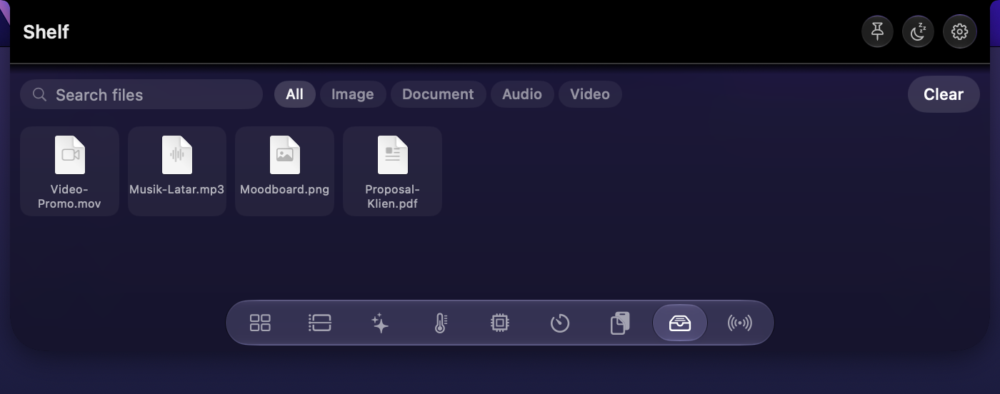

**Bluetooth**

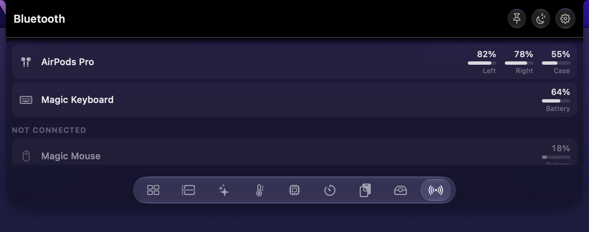

**Pengaturan → Modul**

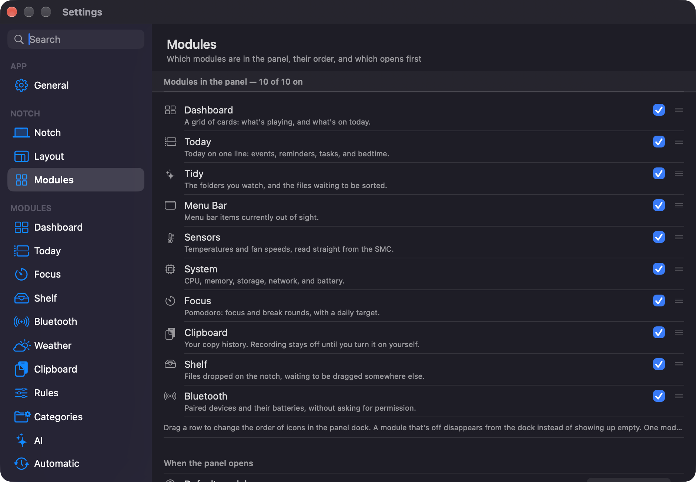

</details>

## Izin

Notchi meminta izin **hanya saat fiturnya dipakai**, tidak pernah saat dibuka pertama kali.
Semuanya bisa ditolak; yang mati hanya bagian itu.

| Izin | Untuk apa | Kapan diminta |
| --- | --- | --- |
| Akses folder | Membaca dan merapikan folder pilihan Anda, dan mengabarkan unduhan selesai | Saat folder ditambahkan, atau kabar unduhan dinyalakan |
| Kalender & Pengingat | Acara dan pengingat hari ini | Saat Anda menekan tombol izinnya |
| Kamera | Cermin kamera — hanya pratinjau, tidak ada yang direkam | Saat tombol kamera pertama ditekan |
| Accessibility | Menggantikan indikator volume macOS; menggeser item menu bar | Saat fitur itu dinyalakan |
| Automation (Music/Spotify) | Mengendalikan pemutar musik | Saat sumber musik dipatok di Pengaturan |
| Screen Recording | Menggambar item menu bar yang tersembunyi (Ice Bar) | Saat Ice Bar dinyalakan |
| Lokasi | Cuaca otomatis | Saat lokasi otomatis dipilih |

**Tanpa izin sama sekali:** panel dan `⌥⌘N`, suhu dan kipas, modul Sistem dan Bluetooth, dan
seluruh kabar di notch yang diam selain unduhan — kabel daya, kamera atau mikrofon yang sedang
dipakai aplikasi lain, headphone yang tersambung, dan perubahan volume.

## Baik diketahui

- **Mengatur RPM kipas belum bisa dari panel.** Daemon kipasnya lengkap dan teruji, tapi belum
  ada tombol yang memanggilnya.
- **Nama sensor di Apple Silicon sebagian masih mentah** (`Tg05`, `TCMz`, …). Nama baru dipasang
  setelah ada bukti pembandingan sungguhan, bukan tebakan.
- **Modul Menu Bar** bergantung pada perilaku macOS yang tidak dijamin stabil antar versi, dan
  susun ulang item tidak berhasil pada semua aplikasi.
- **Belum dinotarisasi**, karena itu ada langkah 3 di bagian Unduh.

<details>
<summary><b>Kontrol kipas</b></summary>

<br>

Daemon kipas dipasang dengan:

```bash
sudo /Applications/Notchi.app/Contents/Resources/install-helper.sh
```

Daemon memeriksa sidik salinan aplikasi yang dipasang, jadi jalankan lagi perintah itu setiap
kali Notchi diperbarui. Mencopotnya: `sudo …/Contents/Resources/uninstall-helper.sh`.

</details>

## Mencopot

Seret **Notchi** ke Trash. Setelan tersimpan di `~/Library/Preferences` dan
`~/Library/Application Support/Notchi` — hapus kalau ingin bersih total. Folder yang sudah
dirapikan tidak berubah; berkasnya tetap di tempat barunya.

## Umpan balik

Laporan galat dan usulan lewat [Issues](https://github.com/rlyno/notchi/issues). Sertakan versi
macOS, model Mac, dan versi Notchi (ada di **Pengaturan → Umum**).

## Lisensi

Notchi adalah **freeware** — gratis dipakai, termasuk untuk keperluan komersial. Kode sumbernya
tertutup; repositori ini hanya berisi halaman unduhan, dokumentasi, dan pelacak isu.

Notchi ditulis dari nol. Ice dan boring.notch dipakai sebagai **referensi perilaku** saja — tidak
ada baris kode dari keduanya yang disalin.

© 2026 RLYNO
